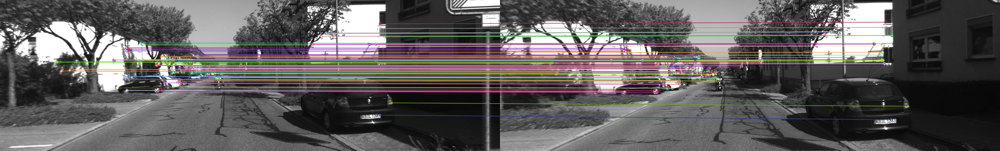
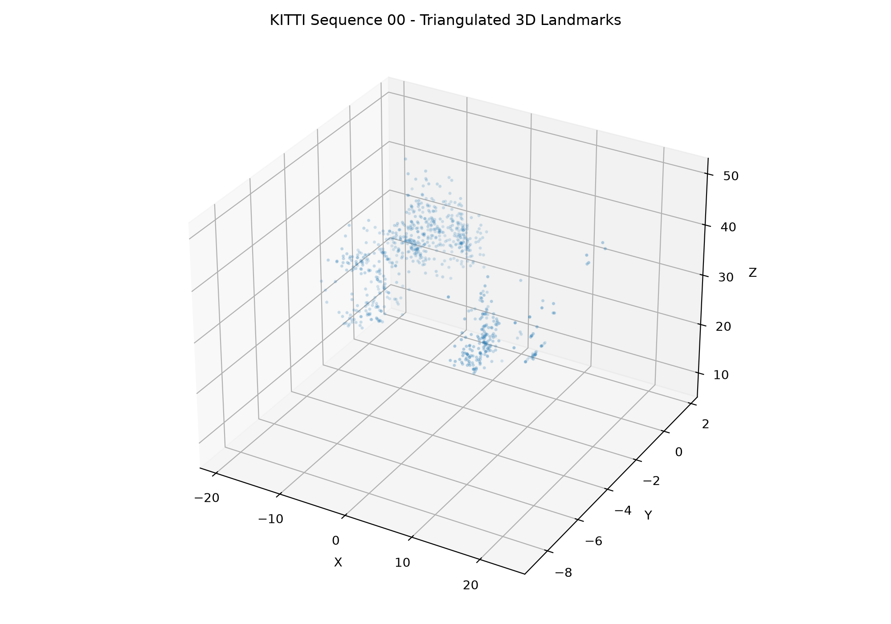
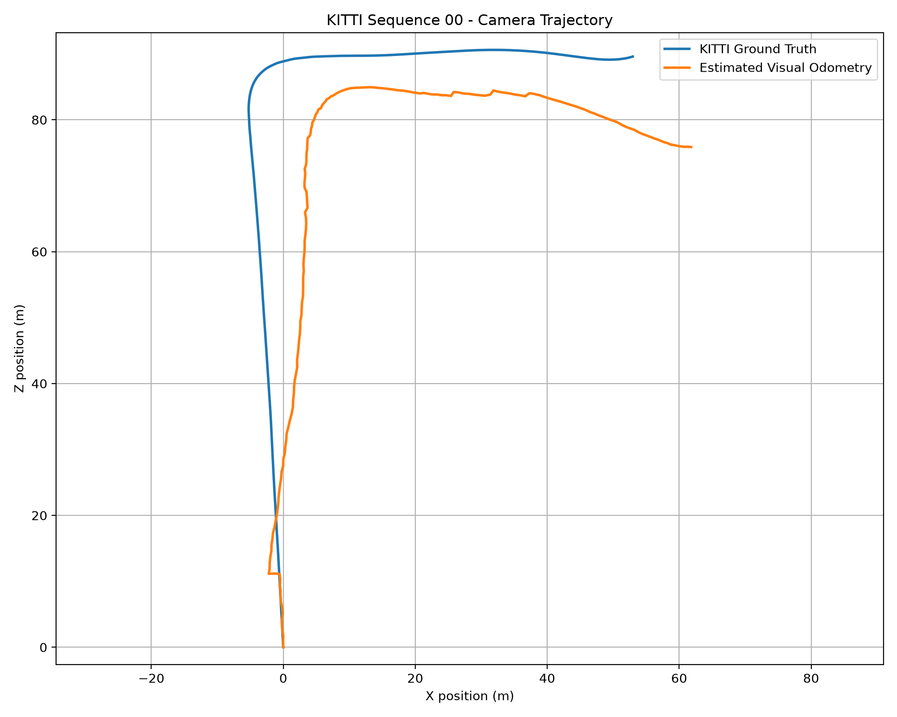

# Task 1 — Monocular Visual Odometry

## Overview

This project implements monocular visual odometry using Python, OpenCV, and the KITTI dataset. The goal is to estimate camera movement from consecutive images and compare the estimated trajectory with the actual trajectory.

The implementation is based on the [Monocular Visual Odometry C++ example](https://github.com/thehummingbird/robotics_demos/tree/main/monocular_vo).

## Implementation

The project performs four main steps:

1. **ORB Feature Matching:** Detects and matches features between consecutive camera images.
2. **Essential Matrix and Pose Estimation:** Calculates the camera's relative rotation and translation direction.
3. **3D Triangulation:** Estimates the locations of 3D landmarks using matched features.
4. **Camera Trajectory:** Estimates the camera path and compares it with KITTI ground truth.

## Dataset

- KITTI Odometry Dataset — Sequence 00
- 4,541 available images
- First 200 frames used for trajectory estimation

## Results

| Measurement | Result |
|---|---:|
| ORB feature matches | 1,221 |
| Pose inliers | 820 |
| Triangulated 3D landmarks | 820 |
| Successful trajectory updates | 199 |
| Skipped updates | 0 |
| Trajectory RMSE | 10.117 m |
| Final position error | 16.407 m |

### ORB Feature Matching



### 3D Landmark Triangulation



### Camera Trajectory Comparison



The estimated trajectory follows the general shape of the actual path but shows some drift as the camera moves.

The implementation uses KITTI ground-truth movement distances to provide translation scale because monocular visual odometry cannot determine absolute scale from two images alone.

## Running the Code

Install the required Python packages:

```bash
pip install opencv-python numpy matplotlib
```

Place KITTI sequence 00 images and calibration files in `kitti_dataset/sequences/00/` and the ground-truth pose file in `kitti_dataset/poses/00.txt`.

Run:

```bash
python orb_features.py
python essential_matrix.py
python triangulation.py
python camera_trajectory.py
```

Results are saved in the `results/` directory.

## References

- [KITTI Odometry Dataset](https://www.cvlibs.net/datasets/kitti/eval_odometry.php)
- [Monocular Visual Odometry Reference Code](https://github.com/thehummingbird/robotics_demos/tree/main/monocular_vo)
