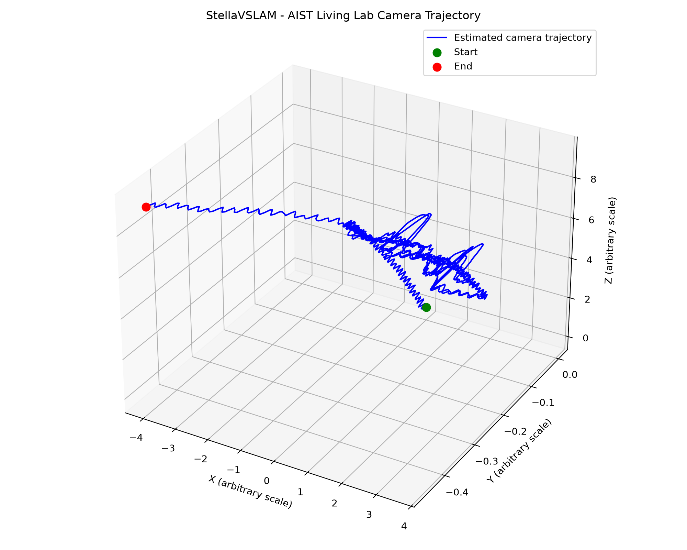
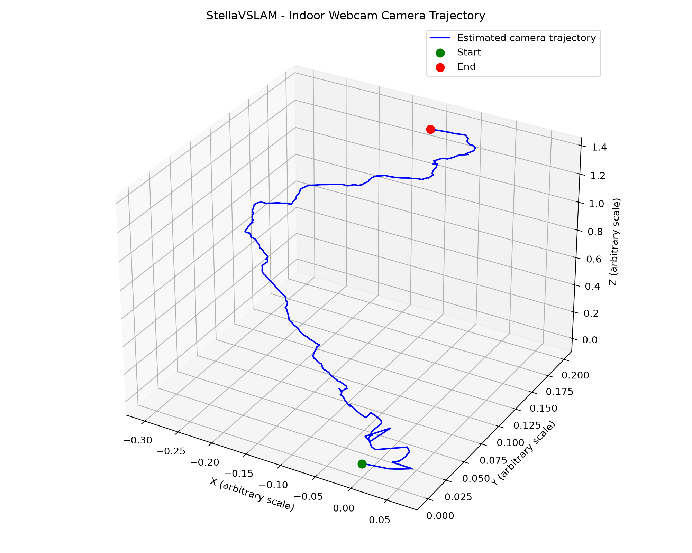

# Assignment 3 — Task 2: StellaVSLAM

## Overview

This task uses StellaVSLAM to perform visual simultaneous localization and mapping (SLAM) using the AIST Living Lab dataset and a video recorded with a laptop webcam.

## Environment

- Ubuntu 24.04 (WSL)
- Docker
- StellaVSLAM with SocketViewer
- Python, OpenCV, NumPy, and Matplotlib

## Experiment 1: AIST Living Lab

StellaVSLAM was run on the `aist_living_lab_1` panoramic video using the provided camera configuration and ORB vocabulary.

The system successfully generated a sparse 3D map and estimated the camera trajectory. Loop closure was detected between keyframes 30 and 112.

### Results

| Measurement | Result |
|---|---|
| Camera poses | 1,359 |
| Keyframes | 221 |
| Trajectory duration | 135.80 seconds |
| Average tracking time | 25.3 ms |
| Estimated tracking throughput | 39.51 FPS |

### SocketViewer Mapping

### Camera Trajectory

## Experiment 2: Indoor Webcam

A video was recorded indoors using a laptop's built-in webcam at 1920 × 1080 resolution.

The camera was calibrated using OpenCV and an 8 × 6 internal-corner checkerboard. The RMS reprojection error was 0.353 pixels.

StellaVSLAM successfully initialized, generated a sparse 3D map, and estimated the camera trajectory.

### Results

| Measurement | Result |
|---|---|
| Camera poses | 238 |
| Keyframes | 27 |
| Trajectory duration | 11.85 seconds |
| Average tracking time | 27.3 ms |
| Estimated tracking throughput | 36.61 FPS |
| Calibration RMS error | 0.353 pixels |

### Camera Trajectory

## Comparison

Both experiments successfully generated maps and camera trajectories.

The indoor webcam experiment produced a shorter trajectory, indicating that tracking was more limited than in the AIST reference experiment.

Because both experiments used monocular SLAM, the estimated trajectory scale is arbitrary. The reported FPS values represent estimated tracking throughput, not the full SLAM processing rate.

## Python Scripts

- `calibrate_webcam.py` — calibrates the laptop webcam
- `plot_aist_trajectory.py` — plots the AIST trajectory
- `analyze_aist_tracking.py` — analyzes AIST tracking performance
- `plot_indoor_trajectory.py` — plots the indoor trajectory
- `analyze_indoor_tracking.py` — analyzes indoor tracking performance

The SLAM map databases (`aist_map.msg` and `indoor_map.msg`) are stored locally and excluded from GitHub.

## References

- [StellaVSLAM](https://github.com/stella-cv/stella_vslam)
- [SocketViewer](https://github.com/stella-cv/socket_viewer)
- [Assignment 3 — Visual SLAM](https://aegean.ai/aiml-common/projects/robotics/visual-slam/visual-slam)